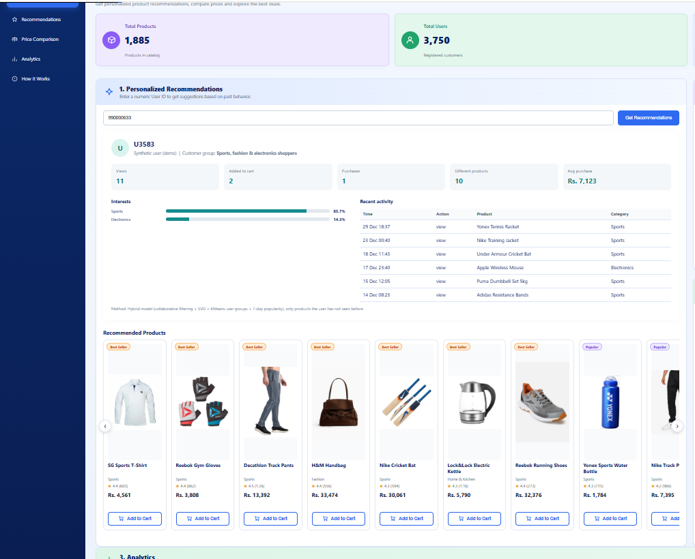

# ShopSmart: E-Commerce Product Recommendation System

**[Live Demo](https://ecommerce-recommender-two.vercel.app)**


## Overview
ShopSmart is an e-commerce recommendation system that suggests products to customers based on their **browsing and purchase history** (views, add-to-cart, purchases). Customers with no history (**cold start**) get popular-product recommendations instead.

The project covers the full pipeline: data cleaning and analysis, building and comparing recommendation models in a Jupyter notebook, and a Flask web dashboard that serves the recommendations.

## Key Features
- Personalized top-10 product recommendations for existing users
- Cold-start recommendations for new users with no history
- Hybrid model combining item-based collaborative filtering, SVD, user clustering and popularity
- Price and quality comparison of the same product across sellers
- Analytics page and a "How It Works" page inside the dashboard
- Product details and images
- Time-based train / validation / test split to avoid data leakage

## How It Works
1. **Implicit ratings:** view = 1, add to cart = 1.5, purchase = 2 (capped at 2), stored in a sparse user x product matrix.
2. **Models compared:** Popularity (last 7 days), Item-based CF (cosine similarity), SVD, NMF and K-Means user clusters.
3. **Hybrid recommender:** CF, SVD, clusters and popularity are blended with equal weights, and products a user already bought are filtered out.
4. **New users:** if a user has no history, the system recommends the most popular products of the last 7 days.
5. **Evaluation:** Hit@10, Precision@10 and NDCG@10 with bootstrap confidence intervals and a rolling backtest. Full details are in the notebook.

## Dashboard Screenshots

### Home


### Personalized Recommendations


### Price Comparison


### Analytics


## Technologies Used
- Python, Pandas, NumPy, SciPy
- Scikit-learn, Statsmodels
- Flask
- HTML, CSS, JavaScript
- Jupyter Notebook
- Vercel (deployment)

## Project Structure
```text
ecommerce-recommender/
│
├── app/
│   ├── app.py                  # Flask application
│   ├── recommender.py
│   ├── recsys.py
│   ├── recsys_v2.py            # Recommender class used by the app
│   ├── recommendations_top10_all.csv
│   ├── cold_start_top10.csv
│   ├── metrics.json
│   ├── templates/              # HTML pages
│   └── static/                 # CSS and product images
│
├── data/                       # Products, users and seller data
├── models/                     # Trained model files
├── notebooks/                  # Full analysis and modeling notebook
├── assets/                     # Workflow diagram and screenshots
├── requirements.txt
└── README.md
```

## Dataset Note
The data contains real user interactions plus **synthetic users** (IDs from 990000001) that are used for demonstration. The real-user model is trained on real users only.

## How to Run Locally

```bash
# 1. Clone the repository
git clone https://github.com/nooria-safdar/ecommerce-recommender.git
cd ecommerce-recommender

# 2. Create and activate a virtual environment (Windows)
python -m venv venv
venv\Scripts\activate

# 3. Install dependencies
pip install -r requirements.txt

# 4. Run the application
python app/app.py
```

Then open `http://127.0.0.1:5000` in your browser.

## Project Goal
To improve product discovery in an online store by giving each customer relevant recommendations, including customers who are new and have no history.

## Author
**Nooria Safdar**
GitHub: [nooria-safdar](https://github.com/nooria-safdar)
